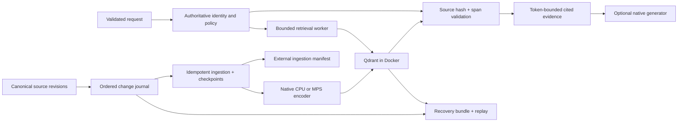

# Architecture and worked design defense

The reference system serves source-grounded retrieval with explicit revision, tenant, and representation contracts. The course is a laboratory for deciding what a real product needs; the local identity fixture, SQLite single-writer journal, tiny datasets, and one Docker host are deliberate boundaries.

## Start with contracts

The canonical document key is an ID plus opaque revision, qualified by tenant. Revisions are immutable: changed text requires another revision. Source spans use character offsets and a SHA-256 hash, defined before chunking. A chunk ID includes its source and representation. This lets evaluation survive chunker changes and makes retries converge. An ordered source journal supplies change order; sorting revision strings does not.

An embedding contract includes model repository/revision, tokenizer limits, query/document roles and prefixes, normalization, dimensions, and representation strategy. Equal dimensions do not imply compatible spaces. Qdrant collection metadata verifies this contract before queries and writes. A model upgrade needs a versioned collection and a matching query encoder. Device choice is recorded but is not a new semantic space when measured numerical drift is acceptable.

The source journal and current policy are authoritative. Qdrant is a derived retrieval index. A current policy check may exclude a deleted or revoked source before asynchronous physical cleanup. Durable deletion must also cover replicas, backups, caches, logs, and external manifests under a defined retention policy. The course demonstrates bounded logical deletion and replay, not secure erasure of all historical bytes.

## Retrieval choices and their evidence

| Requirement | Starting design | Evidence that can justify more complexity |
| --- | --- | --- |
| Exact identifiers, structured facts | SQL/key lookup or lexical search | Measured paraphrase failures justify dense retrieval. |
| Semantic passage search | Small normalized dense encoder with exact reference search | A sufficiently large corpus and measured latency justify HNSW. |
| Mixed identifier and paraphrase queries | Lexical/dense rank fusion | Evaluate candidate recall, held-out relevance, and added inference cost. |
| Fine candidate distinctions | Cross-encoder or token MaxSim rescoring | Candidates must contain relevant sources; rerankers can regress. |
| Large vector footprint | Width/quantization/on-disk experiments | Measure fidelity and semantic quality separately, actual disk/memory, build costs, and latency under pressure. |
| Relationship queries | Structured lookup or provenance-backed graph | Graph traversal helps only with valid entities/edges and bounded expansion. |
| Visual pages | Text baseline plus image/page retrieval | Layout, tables, small text, languages, and source-grounded evidence extraction need dedicated judgments. |
| Answers rather than documents | Bounded context plus real local generator | Separate retrieval coverage, claim correctness, citation support, and abstention. |

The reference SciFact comparison includes a reranker regression. Tiny routing fixtures can yield zero accepted requests at a conservative development threshold. Full context can still produce contradictory reset advice, false abstention, or incorrect citations. These are reasons to calibrate product-specific acceptance criteria rather than assume newer techniques improve quality. See `RETRIEVAL_RESULTS.md`, `RAG_RESULTS.md`, and `ADVANCED_RESULTS.md`.

## Serving and access

The local API accepts a query and retrieval mode, never a caller-supplied tenant or arbitrary filter. Known demonstration tokens resolve to server-owned identities. Current authorized document revisions constrain every dense, sparse, and hybrid branch. Returned text must match canonical spans. Cache keys include identity, tenant, policy/source epoch, representation, collection, and query. Policy is checked around work and before responding.

A production identity adapter must validate an issuer/audience, signature, expiry, and revocation policy with a real provider; demo tokens do not implement this. Do not expose Qdrant directly to clients. Add network isolation, TLS, authenticated service credentials, secret rotation, audit/retention rules, and production policy ownership. A revocation after the final check can race with network delivery; define the consistency/latency requirement rather than promise cross-store atomic authorization.

The worker pool bounds native computation. Request timeout does not terminate a running Python/native model task; its slot remains occupied until actual completion. Overload returns 429 and bounded clients retry within an overall budget. Process isolation can provide stronger cancellation at the cost of model duplication, IPC, and restart latency. The local API serves retrieval; notebook generation is not a deployed generation service.

## Migration and recovery

Backfill a new representation from a source snapshot at a known journal watermark. Replay ordered changes and tombstones to both old and new indexes, persist each consumer checkpoint only after remote writes complete, and reconcile source mappings. A repeated event must converge after a crash between remote write and checkpoint. Cut over only when the target is caught up, the query encoder contract matches, and policy is current. The demonstration drains/recreates the service around Qdrant alias changes; alias atomicity alone does not update application encoders or policies.

Keep the old index consuming changes for a bounded rollback window. Rolling back the application must not restore old permissions or resurrect deleted content. Account for dual storage, duplicate encoding, journal retention, and operational staffing.

A recovery bundle needs Qdrant snapshots, ingestion manifests, current or replayable source state, policy history/current policy, model/configuration artifacts, aliases, and checksums. Restore into a clean target, verify point IDs/payloads/vectors, replay subsequent changes, reconcile, then reopen serving after current-policy tests. The local RTO begins at snapshot upload and excludes detection, host provisioning, and remote download. Its RPO measures missing retained journal events, not source events that were never durably captured.

## Production decision gates

Before deploying, replace fictional task labels with a human-reviewed representative holdout, including languages, source families, time ranges, no-answer cases, and adverse slices. Freeze decisions before evaluating the test set; further tuning requires a new holdout or explicit reused-test reporting. Calibrate automated judges against human claim review.

Measure ingest rate, queue depth, freshness lag, candidate/evidence coverage, embedding and server stage time, timeout/rejection rate, cache behavior, memory/disk growth, and recovery duration. Use load arrival patterns and corpus sizes that model the product; do not extrapolate p99 or cluster availability from this laptop. Define numeric SLO/RTO/RPO and error budgets before experiments, then exercise saturation, dependency failure, corruption, stale policy, and recovery.

Three containers on one Mac share power, storage, VM, and host failure. Independent-host replication, network partitions, rolling upgrades, backups outside the failure domain, capacity under degraded replicas, and incident operations remain unqualified. The course uses Qdrant 1.17.1 intentionally; evaluate compatibility and security changes against [Qdrant's documentation](https://qdrant.tech/documentation/) before a production upgrade.

## Reference choice

For this course, CPU MiniLM plus lexical/hybrid baselines provides a transparent small retrieval system. Native MPS bfloat16 Qwen makes real generation feasible without paid APIs, but observed correctness failures rule out unattended support answers. Advanced models remain explicit downloads. We retain exact search as a fidelity oracle, source-grounded evaluation, and simple independently runnable notebooks. The design earns extra stages only through measured quality or operational need.
