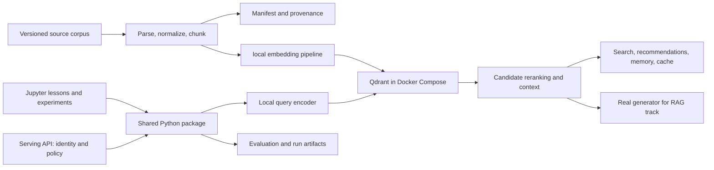

# Vector Storage Masterclass: curriculum and implementation blueprint

Design date: October 30, 2026. Revision: 3, incorporating the design review and the macOS-only CPU/MPS scope update. Status: ready for phased implementation planning; no runtime or performance claims have been validated in this workspace.

The [lesson contracts](LESSON_CONTRACTS.md) define executable lesson boundaries and completion evidence. The [implementation plan](IMPLEMENTATION_PLAN.md) defines delivery order, dependencies, and verification gates. Model choices, compatible dependency versions, and resource limits are finalized by the first Apple Silicon pilot, not assumed validated by this design.

## Outcome and scope

Teach an AI engineer to select, build, explain, evaluate, and operate a retrieval system. A graduate should be able to justify a design using measured relevance, latency, freshness, cost, and failure behavior, and recognize when vector search is unnecessary.

Use Qdrant as the concrete implementation while teaching transferable information-retrieval and systems concepts. Cover the full lifecycle: source data, representations, indexes, retrieval, downstream applications, evaluation, serving, migration, recovery, and retirement.

“State of the art” is a maintained research track, not a claim that one technique wins every workload. Record paper dates, model revisions, supported server/client versions, and reproducible comparisons. Separate established methods, experimental extensions, and research-only discussion.

Prerequisites: basic Python, HTTP/JSON, SQL familiarity, and basic statistics. Provide a short linear algebra and information-retrieval refresher. No prior vector-database experience required.

Planning estimate: 40–60 hours for the core course including exercises; another 20–40 hours for applications, advanced labs, and the capstone. These are teaching estimates to revise after piloting, not measured completion times.

## Fixed constraints and proposed defaults

- Python and uv, with one project environment, a lockfile, a selected Python version, and an explicitly verified notebook kernel.
- Qdrant server in local Docker Compose. Use the actual server for integration exercises; embedded/local client mode is not a substitute for server behavior.
- Target macOS on Apple Silicon only. Run Python and model inference natively on CPU or Metal through PyTorch MPS; Qdrant remains in the Linux Docker VM on CPU. Choose devices per model using measured latency, quality, and unified-memory cost. Pin model revisions and record actual device, tokenization, prefixes, normalization, dimensions, and precision. Requested MPS must fail clearly when unavailable; fallback is an explicit configuration decision.
- Jupyter notebooks for explanations, executable experiments, visualizations, exercises, and interpretations. Shared implementation lives in a small Python package.
- Default local operation after an explicit initial download of packages, container images, model weights, and datasets. Provide preflight checks for offline availability and artifact licenses/checksums.
- Select a small dense encoder and small cross-encoder after a Apple Silicon pilot. Sentence Transformers is the proposed teaching interface; ONNX/FastEmbed is an optional comparison. Do not silently change models while comparing runtimes.
- Use NumPy, pandas, Matplotlib, and modest ipywidgets interaction. Export readable static versions of interactive results.
- Avoid a mandatory orchestration framework. Teach the retrieval pipeline directly; framework adapters can be optional later.
- A small versioned filesystem corpus and SQLite ingestion manifest are sufficient initially. Qdrant is a derived search index, with source content and provenance retained separately.
- Add a small HTTP service, proposed FastAPI, when teaching serving and authorization. Early notebooks use the Qdrant client directly; security exercises use the service boundary.
- Two execution profiles: retrieval-only and live RAG. Retrieval-only requires no generator. Completing the RAG track requires real generation, citation checking, and no-answer evaluation; completing the full masterclass includes that track. A small local CPU/MPS generator is the intended baseline, selected by the pilot. Hosted generation is an explicit optional adapter, not a prerequisite. An extractive evidence viewer or recorded fixture must be labeled accordingly and never represented as live generative RAG.

The inference track compares CPU and MPS with identical model revisions, warmup, device synchronization, batching, thread counts, sequence lengths, and cache behavior. Optional ONNX INT8 remains a CPU-specific comparison. MLX is a possible later backend only if it offers a measured benefit worth another environment; it is not required for the initial implementation. Model-weight quantization and stored-vector quantization are separate experiments. Backend changes require quality checks, not just throughput measurements. See [Sentence Transformers efficiency documentation](https://www.sbert.net/docs/sentence_transformer/usage/efficiency.html). Follow [uv's Jupyter integration guidance](https://docs.astral.sh/uv/guides/integration/jupyter/) for kernel/environment alignment.

## Proposed notebook sequence

The numbers below identify topic families, not a promise of exactly 30 notebooks. Overloaded families are split into explicit suffixed notebooks in the [lesson contracts](LESSON_CONTRACTS.md). Each executable notebook has one primary experiment, prerequisites, an execution/resource profile, an output artifact, and a completion check. Core notebooks should be independently restartable after documented setup.

| ID | Topic and learning outcome | Experiment or visible evidence |
| --- | --- | --- |
| 00 | Environment, prerequisites, learning map | Verify selected CPU/MPS device, kernel, server version, model cache, and a tiny insert/query round trip. |
| 01 | Vector geometry | Implement cosine, dot product, and Euclidean distance; visualize normalization and rankings on hand-checkable vectors. |
| 02 | Embeddings and their limitations | Inspect tokenization, truncation, asymmetric query/document encoding, negation, identifiers, and semantic versus topical similarity. |
| 03 | Exact retrieval and lexical baselines | Build NumPy exhaustive nearest-neighbor search and a BM25 baseline; show examples where each wins. |
| 04 | Evaluation before optimization | Create relevance judgments; compute Recall@k, MRR, and nDCG; distinguish ANN recall from relevance recall. |
| 05 | Qdrant data model and life of a write | 05a covers collections, IDs, vectors, payloads, and CRUD. 05b traces persistence, segments, indexing/optimization, write visibility, updates, deletes, and restart behavior under concurrent reads. |
| 06 | Ingestion as a repeatable data pipeline | Parse source documents; assign stable IDs; retain provenance; retry interrupted batches without duplicates. |
| 07 | Chunking and context | Compare fixed, structural, and parent/child chunks using source-span judgments, document deduplication, and fixed context-token budgets. Generated contextual enrichment belongs to live-RAG lesson 13b. |
| 08 | Metadata filters and access boundaries | Compare indexed filters and selectivity; exercise tenant, document-version, and temporal constraints. |
| 09 | Approximate nearest-neighbor search | Use a dedicated ANN configuration and readiness gate; explain HNSW parameters, compare with exact results at matched filters, and plot recall/latency only when the intended index experiment is valid. |
| 10 | Dense, sparse, and hybrid retrieval | Explain BM25 versus learned sparse representations; compare dense, lexical, sparse, and fusion on the same judgments. |
| 11 | Reranking and diversity | Add a local cross-encoder; vary candidate count; implement MMR and document grouping; inspect gains and regressions. |
| 12 | Evidence assembly and live RAG | 12a builds an evidence package without a generator. 12b requires real generation, citation-support checks, contradictory evidence, and no-answer tests to complete the RAG track. |
| 13 | Model-assisted retrieval | Split live experiments into 13a query rewriting/decomposition, 13b generated contextual enrichment, and 13c bounded iterative retrieval. Include call budgets, failure cases, and comparisons with unmodified retrieval. |
| 14 | Recommendation and discovery | Build content-based item recommendations with exclusions, diversity, freshness, and a temporal evaluation split. |
| 15 | Deduplication and entity matching | Compare near-duplicate candidate generation with verification; plot threshold precision/recall and false-merge costs. |
| 16 | Semantic caching and routing | Separate cache false-hit/invalidation tests in 16a from routing and tool-selection abstention in 16b. |
| 17 | Agent memory | Retrieve episodic records with timestamps and provenance; implement corrections, expiration, deletion, and access tests. |
| 18 | Classification, clustering, and anomaly triage | Separate supervised neighbor voting, exploratory clustering, and anomaly triage into 18a–18c, each with distinct labels and success criteria. |
| 19 | Multilingual, code, and multimodal retrieval | Separate multilingual, code, and image/text retrieval into 19a–19c; each selects appropriate encoders and its own evaluation slice. |
| 20 | Storage and inference efficiency | Separate CPU/MPS inference tuning (20a), stored-vector quantization/rescoring (20b), and on-disk storage/capacity (20c); keep one cost mechanism per experiment. |
| 21 | Matryoshka and multi-stage retrieval | Use a compatible trained model for dimension reduction; compare candidate retrieval and full-resolution rescoring. |
| 22 | Multi-vector late interaction | Implement MaxSim on hand-checkable matrices, then a small locally encoded example using Qdrant multivectors. |
| 23 | Research extensions | Separate visual documents (23a), graph-assisted retrieval (23b), multi-vector compression (23c), and long-context alternatives (23d). Contracts distinguish live execution from replay or analysis. |
| 24 | Serving architecture | Build request validation, timeouts, bounded concurrency, retries, authorization, batching, and tracing around the shared package. |
| 25 | Index lifecycle and embedding migration | Backfill a new collection, handle concurrent changes, shadow queries, switch aliases, roll back, and validate deletion propagation. |
| 26 | Performance, observability, and capacity | Run controlled load; separate embedding, search, rerank, and generation time; chart throughput, p50/p95/p99, errors, RAM, and disk. |
| 27 | Recovery, replication, and failure drills | 27a restores a clean single-node target and verifies external metadata. Optional higher-resource 27b investigates node loss, read consistency, and write behavior in a three-node Compose profile. |
| 28 | Security and adversarial retrieval | Test tenant isolation, malicious payloads, unauthorized documents, prompt injection, poisoning, sensitive logging, and stale permission state. |
| 29 | Capstone and design review | Deliver an evaluated retrieval service with an architecture decision record, resource budget, migration, recovery evidence, and known limitations. |

The retrieval and operations path is 00–11 (including 05a/05b), 12a, 20a–20c, 24–26, 27a, 28, and 29. The RAG track adds 12b and 13a–13c. Application labs 14–19 and advanced labs 21–23 branch from the explicit prerequisites in the lesson contracts. The full masterclass includes these tracks; 27b remains a separate resource-dependent extension. A shorter path must state which outcomes it omits. In lesson 28, prompt-injection tests involving generator behavior require the live-RAG profile; retrieval authorization tests remain available without generation.

### Execution and completion profiles

Retrieval-only runs local embeddings and, when required, a CPU reranker. Live RAG additionally runs a real selected generator and records backend, model revision, prompt, decoding configuration, call count, and latency. Model-driven rewrites and contextual enrichment use the live profile. Supplied transformations may be used for isolated retrieval tests, but are labeled fixtures and do not satisfy live-profile completion checks.

Research notebooks may use provenance-backed replay artifacts when the full encoder exceeds the laptop budget. They must still execute their analysis/scoring cells locally, disclose which upstream work was precomputed, and provide recomputation instructions. Replay earns an analysis outcome, not evidence of live local-model feasibility or reproduction of published performance.

The supported platform is macOS on Apple Silicon only. Windows, Linux learner hosts, Intel Macs, and CUDA are outside the course support scope. Docker runs Qdrant, while models run natively to access Metal. Proposed pilot envelope: a 16 GiB host, up to 6 GiB allocated to the default Qdrant container, and a 20 GiB combined core download/cache/data budget. These are design targets, not measured minimum requirements. Run memory-heavy stages sequentially; record host memory pressure and Python/Docker memory, plus MPS allocated/driver memory separately to avoid assuming unified-memory allocations are disjoint. The pilot must reduce data/model size or revise the published requirements if these targets cannot be met. Multi-node and research profiles declare separate budgets and do not silently raise the core requirement.

## Advanced coverage and research boundaries

- Hybrid and multi-stage retrieval: candidate generation, rank fusion, reranking, filtering at each stage, and candidate starvation. Qdrant documents dense/sparse combinations, nested prefetch, and fusion; version-gate API use rather than assuming every installed version supports every example. [Qdrant Query API concepts](https://qdrant.tech/documentation/hybrid-queries/)
- Matryoshka representation learning: variable dimensionality with an appropriately trained model. Arbitrary truncation of an ordinary embedding is not equivalent. [Original research](https://arxiv.org/abs/2205.13147)
- Late interaction: token-level representations and MaxSim, with explicit storage and compute comparisons. A Qdrant MaxSim demonstration does not reproduce the complete ColBERTv2 training, compression, or serving stack. [ColBERTv2](https://arxiv.org/abs/2112.01488)
- Contextual retrieval: enrich chunks with document context and measure effects independently of fusion and reranking. Generated context adds ingestion cost and can introduce errors. [Anthropic's method and experiments](https://www.anthropic.com/research/contextual-retrieval)
- Graph-assisted retrieval: compare relationship traversal and corpus-wide summarization with ordinary retrieval. Qdrant can retrieve vectorized entities or summaries; graph construction/traversal is an additional component, not a native substitute supplied by vector storage. [GraphRAG query modes](https://microsoft.github.io/graphrag/query/overview/)
- Visual document retrieval: study page-image multi-vector representations and the cost of preserving layout. Heavy encoders may require labeled precomputed artifacts for the normal lesson; provide Apple Silicon recomputation instructions and realistic resource limits before calling a lab executable. [ColPali](https://arxiv.org/abs/2407.01449)
- Multi-vector compression: explain fixed-dimensional encodings, candidate recall, and exact late-interaction rescoring. A pedagogical implementation is not a performance reproduction of the research system. [MUVERA](https://research.google/blog/muvera-making-multi-vector-retrieval-as-fast-as-single-vector-search/)
- Representation adaptation: teach contrastive objectives, hard negatives, distillation, domain adaptation, and evaluation leakage. A tiny CPU training exercise can demonstrate mechanics; frontier-scale training is outside the local course budget.
- Cover HNSW versus IVF/PQ, disk-oriented ANN, flat scans, and search-engine/database alternatives conceptually. Clearly label algorithms that are not implemented by the pinned Qdrant configuration.
- Compare long-context prompting and structured SQL lookups as alternatives for appropriate workloads. Multi-hop or agentic retrieval adds failure paths and needs explicit limits and evidence of benefit.

## Teaching architecture



The online service derives tenant/access constraints from authenticated context. Users must not be able to remove those constraints through request payloads. Apply restrictions before candidate selection and check authoritative permissions before returning protected content. Test every retrieval branch, reranking input, cache, and fallback path for leakage.

The ingestion manifest records source ID/revision, content hash, parser/chunker versions, model ID/revision, embedding configuration, point IDs, ingestion status, and deletion state. Qdrant does not provide an atomic transaction with the external source store: teach retryable transitions, reconciliation, tombstones, and repair.

A model or chunking migration creates a new explicitly versioned index. Dual writing, an outbox, or replaying a change log must close the gap between backfill and cutover. Switching an alias alone does not establish freshness or synchronization. Include rollback behavior and deletion races in the exercise.

## Data and experiment design

Use a fictional engineering support corpus across the core course: manuals, release notes, troubleshooting tickets, product specifications, and policy documents. Include version conflicts, identifiers, similar products, multiple tenants, obsolete advice, negation, and unanswerable questions. Keep a clear license and no real personal data.

Complement it with a small licensed real-world retrieval benchmark for external validity. Synthetic cases provide controlled failures but cannot establish general retrieval quality. Add small application-specific datasets for recommendations and multimodal work rather than forcing every task into one corpus.

Provide three dataset profiles, with sizes adjusted after the Apple Silicon pilot:

- Tiny: hundreds of chunks and hand-checkable relevance judgments for fast demonstrations.
- Standard: thousands to tens of thousands of chunks for realistic notebook comparisons.
- Scale: an opt-in larger corpus for index/resource experiments. Generated vectors may illustrate system scaling but must not be used to claim semantic retrieval quality.

Split by source/document family where possible to prevent near-duplicate leakage. Use temporal holdouts for changing catalogs and recommendations. Keep tuning queries separate from a frozen test set. Store query IDs, graded relevance, eligible documents, and annotation rationale; support multiple relevant answers and no-answer queries.

### Relevance contract across chunking and index changes

Store gold evidence against immutable canonical source revisions, not generated chunk IDs. Each evidence item records document ID, source revision, canonical-text hash, and half-open character offsets into that text. Parsing changes create a new canonical revision and require explicit label migration or reannotation. Chunks record source offsets; enriched text retains its original source mapping. A generated summary or contextual prefix is not itself gold evidence.

Define required evidence units per query, including alternatives where several passages support the same fact. Compute each unit's coverage using the union of retrieved source intervals so overlap cannot earn duplicate credit. Freeze the coverage threshold and aggregation rules before tuning. Report document relevance separately: collapse chunks to unique document revisions in first-occurrence rank order before document-level metrics. Retain a chunk-level diagnostic view without using it as a cross-chunker gold standard.

Compare chunking at both fixed candidate k and a fixed context-token budget using one pinned tokenizer and deterministic packing policy. Report evidence coverage, unique relevant documents, duplication, and actual tokens consumed. A larger chunk must not win merely because it supplies more total context unnoticed.

Queries with no eligible relevant evidence are excluded from relevance recall/nDCG aggregates with a reported count; score them in a separate abstention/false-positive evaluation. For partially judged public datasets, follow and record the benchmark's convention, identify unjudged results, and report judgment coverage. Do not claim exhaustive relevance recall from incomplete judgments. Hand-check metric behavior on multiple-relevant, overlapping-chunk, no-answer, and unjudged fixtures before evaluating models.

### ANN experiment validity gate

Lesson 09 uses a dedicated configuration and dataset sized to exercise HNSW; it must not inherit the tiny demonstration configuration blindly. Record segment/index statistics, indexing and full-scan thresholds, vector dimensions, payload indexes, filter cardinality, and optimizer state. Wait for the intended indexing work to finish with a bounded timeout before steady-state measurements. Server readiness or write acknowledgment alone does not establish index readiness.

Use the pinned server version's documented controls to make the intended search mode eligible and inspect available diagnostics. Run unfiltered HNSW/exact comparisons first, then selective-filter experiments that explicitly allow planner-driven scans. An indexed collection alone does not prove every query used HNSW. If execution-path evidence is insufficient, disclose that limitation and do not attribute latency changes to HNSW tuning. A flat parameter sweep is an inconclusive observation, not a manufactured tradeoff curve. See [Qdrant indexing behavior](https://qdrant.tech/documentation/manage-data/indexing/).

Compare approximate and exhaustive results on the same frozen eligible points and distance metric with explicit ties. Record ingestion, index construction, and query timings separately. Measure quality and index fidelity under quiescent data; reserve concurrent mutations for the life-of-a-write and serving labs.

Every run records corpus hash, query/judgment version, git revision when available, model revision, configuration, seed, server/client versions, CPU/GPU/device/OS, Docker resource allocation, warm/cold cache state, timings, and measured outputs. Separate download/setup, embedding, ingestion, indexing, and steady-state query times. Never invent benchmark results or fill missing metrics with illustrative values without an explicit label.

## Testing and acceptance criteria

| Layer | Required evidence |
| --- | --- |
| Mathematical and data correctness | Hand-computed distance/ranking cases; metric formulas; stable IDs; chunk boundaries; schema validation; dimension/model mismatch detection. |
| Real-server integration | Upsert, query, filters, updates, deletes, retries, reruns, aliases, and supported advanced queries against the pinned Compose Qdrant server. |
| Retrieval quality | Dense and lexical baselines; source-span evidence coverage; deduplicated document Recall@k, MRR, nDCG; fixed-token comparisons; explicit no-answer/unjudged conventions; held-out evaluation and slice-level failures. |
| ANN fidelity | Pass the index/readiness and execution-path evidence gate before interpreting parameter sweeps; compare top-k with exhaustive search over the same frozen eligible corpus, vectors, and metric; explicit ties. |
| Application correctness | Cache false-hit rate; dedup false merges; recommendation leakage; memory correction/deletion; routing abstention; citations and source versions. |
| Generative RAG | Real model execution required for RAG-track completion; record configuration and budget; assess answer correctness, citation support, completeness, and abstention separately from retrieval; human-reviewed examples, not sole reliance on a judge. |
| Security | Cross-tenant negative tests, forged filters, revoked access, malicious retrieved instructions, cache partitioning, and log redaction. |
| Performance | End-to-end and stage timing, controlled concurrency, throughput/error rates, sufficient samples for reported percentiles, memory and disk, and cold/warm comparisons. |
| Operations | Restart persistence, interrupted ingestion recovery, restored-query equivalence, migration rollback, deletion propagation, and node-loss exercises where enabled. |
| Notebook delivery | Fresh kernel execution, documented prerequisites, no hidden cell order, repeatable reruns, readable static export, and visual review of plots/tables/diagrams. |

Choose thresholds before the capstone evaluation based on the selected hardware and application. Do not hardcode a universal latency or relevance target. Exact fixtures should have exact expected results; real-model comparisons may need tolerances and rank/quality assertions appropriate to platform variation.

Use pytest for shared code and integration tests, and nbclient/nbconvert for notebook execution/export. Keep slow-model, scale, optional-generation, and multi-node checks separately selectable. Local checks are the initial requirement; hosted CI can be added later if requested.

## Notebook teaching contract

Every notebook should include:

1. A concrete engineering question, prerequisites, and learning outcomes.
2. Intuition, necessary mathematics, and a diagram or hand-worked example.
3. A small implementation students can inspect before using shared helpers.
4. A baseline, one controlled change, and measured results.
5. A visualization that supports the question: rank changes, relevance heatmaps, latency distributions, capacity curves, or failure traces.
6. A deliberate failure case, troubleshooting guidance, and limitations.
7. When to use the approach, when to avoid it, and alternatives.
8. An exercise and a separate worked solution or instructor notes.
9. Reproducibility metadata, cleanup instructions, and production implications.

Two-dimensional embedding projections illustrate geometry but do not establish retrieval quality. Every interactive widget needs sensible default output for static export. Long preprocessing stages should be explicit and resumable. Lesson reruns must use isolated collection names or narrowly scoped cleanup.

Each notebook also declares its canonical lesson ID, prerequisites, dataset/model revisions, execution profile, numeric runtime and memory budget, download size, required artifact paths, and completion checks. The [lesson contracts](LESSON_CONTRACTS.md) supply initial authoring targets; the pilot replaces provisional resource targets with measurements before lesson release. Slow stages may not disappear behind cached output: report fresh execution and cached/replay execution separately.

## Production tradeoffs to teach explicitly

Treat relevance, latency, freshness, reliability, operational burden, privacy, and cost as competing objectives. More dimensions, more candidates, larger rerankers, and more retrieval stages require measured justification.

Capacity starts with raw vector bytes, approximately point count × dimensions × bytes per component. Then measure payloads, indexes, multivector counts, replicas, write-ahead logs, snapshots, temporary build space, and page cache. A raw-vector estimate is not a RAM sizing guarantee.

Lesson 05b supplies the storage foundation for these estimates: trace a batch through acceptance, persistence, visibility, and background indexing; inspect segments and optimization; update/delete during reads; restart and check the documented guarantees. Distinguish logical deletion from later physical space reclamation. Do not infer crash durability from a successful orderly restart. Record which guarantees come from the pinned Qdrant documentation and which behaviors were directly observed locally.

Default Compose should bind published ports to loopback, use persistent volumes, and wait for readiness. Provide explicit destructive-reset commands. Keep API keys out of notebooks and rendered outputs. The security lesson should explain authentication, application authorization, encryption, logging, and network boundaries using [Qdrant security guidance](https://qdrant.tech/documentation/security/).

A three-node cluster on one laptop demonstrates replication mechanics and some failure behavior; it does not prove host, zone, or region resilience. Teach read consistency, write ordering, replication, shard distribution, availability tradeoffs, and reconciliation using the pinned version's semantics. [Distributed deployment documentation](https://qdrant.tech/documentation/scaling/distributed_deployment/)

Backup acceptance means restoring into a clean target and checking configuration, source mappings, and query behavior. A distributed collection snapshot is node-scoped, and collection snapshots do not include collection aliases, so the recovery exercise must account for topology and external metadata. [Qdrant snapshots](https://qdrant.tech/documentation/operations/snapshots/)

Deletion includes the source, all chunk/vector versions, caches, derived artifacts, and defined backup retention behavior. Embeddings should be treated as sensitive derived data, not assumed anonymous.

Production qualification additionally requires representative traffic, real data governance, deployment-specific fault domains, secret management, operational ownership, and application-specific SLOs. The local capstone provides evidence about its tested environment only.

## Proposed repository structure

```text
compose.yaml                 # one-node default; explicit optional profiles
pyproject.toml               # uv project and dependency groups
uv.lock
notebooks/                   # numbered teaching notebooks
src/vector_masterclass/      # ingestion, embeddings, retrieval, evaluation, serving
tests/                       # unit, integration, application, and failure cases
datasets/                    # licensed small corpus, query sets, judgments, manifests
configs/                     # reproducible experiment configurations
scripts/                     # preflight, bootstrap, reset, execute, export, benchmark
artifacts/                   # generated evidence, with retention/ignore rules
docs/                        # curriculum, architecture decisions, instructor runbook
```

This runtime tree is a proposal; the current deliverables are design, lesson-contract, and implementation-plan documents.

## Implementation sequence and decision gates

1. Build one vertical slice: uv/Jupyter, pinned Compose Qdrant, local encoder, tiny corpus, exact and lexical baselines, retrieval metrics, and the first few lessons. Validate install, rerun, export, and plot readability.
2. Complete the core retrieval path through storage behavior, ingestion, filters, ANN, hybrid retrieval, reranking, and evidence assembly. Tune on development queries; reserve frozen test queries for milestone comparisons and do not repeatedly optimize against them.
3. Add non-RAG application labs with their own task metrics and negative cases.
4. Add serving, security, lifecycle, migration, observability, and recovery, using the same tested implementation from the notebooks.
5. Add advanced CPU/MPS experiments and clearly labeled research/replay extensions. Select exact models and methods based on measured feasibility rather than paper prominence.
6. Pilot the course, revise runtime estimates, and finish the capstone, instructor runbook, and reproducible artifacts.

Select the local CPU/MPS generation backend and model during the pilot, before authoring the live-RAG track. Include a real answer with supported citations and an unanswerable case in that feasibility check. If a suitable model cannot meet the declared envelope, revise the profile explicitly; do not replace the required live exercise with a fixture. Detailed milestones and unresolved pilot decisions are tracked in the [implementation plan](IMPLEMENTATION_PLAN.md).
